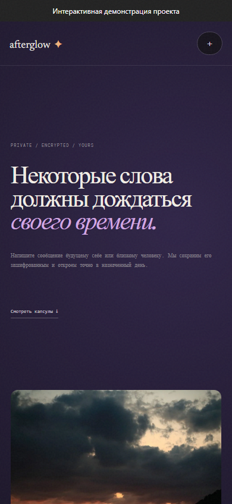

# Afterglow — Time Capsules

Store a password-protected message for opening after a selected date.




[Short interaction recording](docs/demo.gif)

## Implemented

- Create a capsule and open it using its identifier/password after the unlock time.
- Encrypted message storage and server-side date/password validation.

## Stack and architecture

JavaScript, Express, Zod, built-in Node SQLite and a static HTML/CSS interface.

## Technical mechanisms and security

- The server uses scrypt-derived keys, random salts/IVs and AES-GCM authenticated encryption. Public metadata does not contain the plaintext message.
- Malformed JSON now returns a small JSON error without framework stack details.

## Local setup

Node.js 24.18.0 and pnpm 11.7.0 (see version files).

```bash
npm install --global pnpm@11.7.0
pnpm install --frozen-lockfile
pnpm start
```

Open `http://localhost:4800`. For live UI development use `pnpm dev` where available. The API binds to `127.0.0.1` by default.

## Configuration

Configure process environment variables using [.env.example](.env.example). `pnpm start` uses the process environment; it does not implicitly load that file. To load a copied `.env` explicitly, run `node --env-file=.env server.js`.

## Database and upgrades

SQLite is stored at `data/afterglow.db`. Initialization creates/migrates the schema; sample rows are included for local use. Back up the database before upgrades. Do not remove the database as a migration step.

## Verification

```bash
pnpm test
pnpm test:contract
pnpm test:upgrade
pnpm audit --audit-level=high
```

Unit/API tests, malformed-JSON regression, response-shape contract and prior-schema upgrade checks.

CI installs locked dependencies and runs the configured checks; documentation checks also validate local links/images. Node dependency advisories are checked with `pnpm audit --audit-level=high`. A passing scanner only reports known advisories at the time of the run.

## Limits and next steps

- Encryption is server-side, not end-to-end: the server sees the submitted password/message. There is no user-account recovery workflow.
- No capsule-open brute-force limit is implemented; synchronous scrypt can consume CPU. Keep the default loopback binding until authentication/rate limiting is added.

## Further documentation

[Audit findings and follow-up](docs/AUDIT_2026_10.md) · [Technical reference](docs/TECHNICAL.md) · [Change history](CHANGELOG.md)

[API request/response example](docs/API_EXAMPLE.md)
