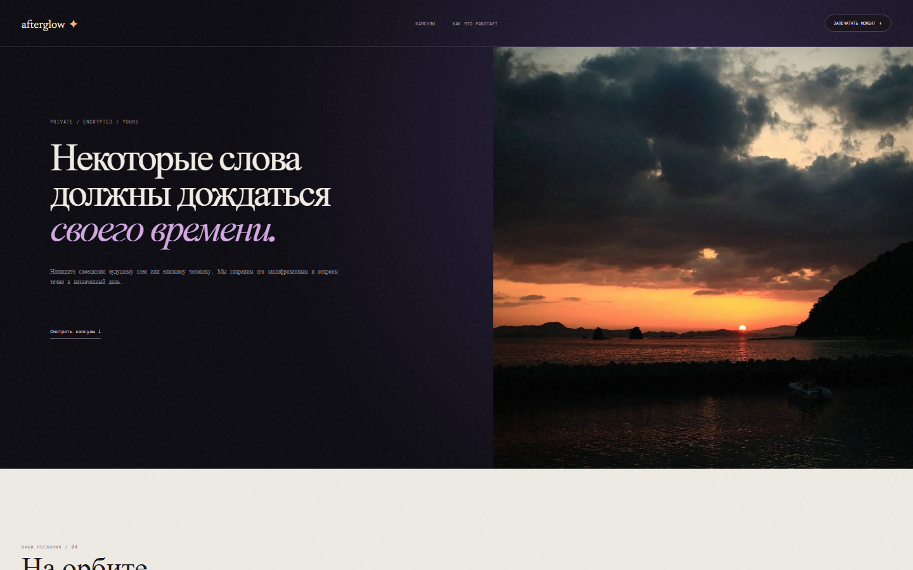
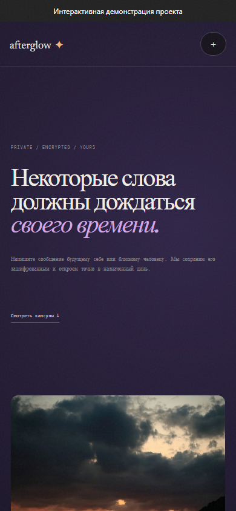

# Afterglow - цифровые капсулы времени

Защищённое паролем сообщение, которое можно открыть после выбранной даты.

[Открыть проект](https://memorim.github.io/afterglow-time-capsules/)





## Возможности

- Создание капсулы, получение её идентификатора и открытие по паролю после срока.
- Сквозное шифрование новых капсул в браузере с помощью пароля и будущего раунда сети drand.
- Адаптивный интерфейс с фотографическим первым экраном.

## Стек и устройство

JavaScript, Express, Zod, встроенный SQLite в Node.js и HTML/CSS.

## Ключевые решения

- Ключи выводятся через scrypt со случайной солью; текст шифруется AES-GCM со случайным IV и проверкой целостности. Публичные метаданные не содержат открытый текст.
- Некорректный JSON возвращает ограниченную ошибку без стека фреймворка.
- Инициализация SQLite выполняется в `BEGIN IMMEDIATE`: два процесса не создают повторные начальные записи. Существующая пустая база не заполняется заново.
- Даты с часовым смещением сохраняются в UTC; повреждённая дата блокирует открытие. Решение принимает сервер, а не часы браузера.

## Локальный запуск

Node.js 24.18.0 и pnpm 11.7.0; версии закреплены в файлах проекта.

```bash
npm install --global pnpm@11.7.0
pnpm install --frozen-lockfile
pnpm start
```

Откройте `http://localhost:4800`. Поддерживается локальная работа одного оператора: сервер слушает только loopback и проверяет адрес соединения, Host и Origin API-запросов. Для разработки доступен `pnpm dev`.

## Настройки

Параметры перечислены в [.env.example](.env.example). `pnpm start` использует окружение процесса и не загружает файл автоматически. После копирования `.env` его можно загрузить явно: `node --env-file=.env server.js`.

## Данные и обновления

SQLite хранится в `data/afterglow.db`. Инициализация создаёт или обновляет схему. Перед обновлением сохраните резервную копию; удалять БД вместо миграции не нужно.

## Проверки

```bash
pnpm test
pnpm test:contract
pnpm test:upgrade
pnpm exec playwright install --with-deps --only-shell chromium
pnpm test:e2e
pnpm audit --audit-level=high
```

Unit/API-проверки включают изменение ciphertext/tag, неверный пароль, точную границу времени, ошибки БД, лимиты запросов и параллельную запись двух процессов в временную БД с последующим открытием. Отдельно проверяются контракт ответа, сохранность предыдущей схемы и браузерное восстановление после ошибки сети.

Браузерные проверки запускают отдельную SQLite в памяти и не используют обычную папку `data`.

CI устанавливает зависимости по зафиксированным версиям и запускает настроенные проверки. Отдельная проверка документации находит неверные локальные ссылки и изображения. Проверка уязвимостей учитывает известные проблемы на момент запуска.

## Ограничения

- Капсулы прежнего формата по-прежнему открываются старым паролем. Для новых капсул браузер шифрует текст с помощью AES-GCM и запечатывает результат до выбранной даты через drand Quicknet. При открытии браузер запрашивает подписанный раунд drand. Заголовок, имена и подсказка доступны как метаданные. [Сеть drand](https://drand.love/)
- При создании капсулы пароль ограничен 4–100 символами, сообщение — 10–3000 символами. API принимает JSON до 32 КиБ и возвращает до 100 капсул за запрос. Общий для базы лимит составляет 10 попыток создания и 30 попыток открытия в минуту. Счётчики сохраняются между перезапусками.
- Публичный режим поддерживает до 100 заранее созданных аккаунтов. Каждому выделяется файл SQLite или отдельная схема PostgreSQL. Изменение списка аккаунтов требует перезапуска.
- По умолчанию капсулы хранятся 365 дней после даты открытия. `CAPSULE_RETENTION_DAYS` задаёт срок от 1 до 3650 дней. Очистка запускается при API-запросах не чаще раза в час. Срок хранения резервных копий настраивается отдельно.

## Документация

[Результаты аудита](docs/AUDIT_2026_10.md) · [Техническая документация](docs/TECHNICAL.md) · [Пример запроса и ответа](docs/API_EXAMPLE.md) · [История изменений](CHANGELOG.md)

## Версия в браузере

На GitHub Pages зашифрованные капсулы сохраняются в хранилище этого браузера и переживают перезагрузку. Для готовой открытой капсулы используется пароль `starlight`. Серверный режим хранит капсулы в базе аккаунта.

Сборка браузерного модуля шифрования выполняется командой `node scripts/build-capsule-crypto.mjs`.

Сборка: `python scripts/build_demo.py`. Проверка адаптера: `node --test demo/demo.test.mjs`.

### Изолированные аккаунты

Для публичного режима задайте `APP_PUBLIC_ORIGIN` (HTTPS origin без завершающего слеша) и `APP_ACCOUNTS`. Последний параметр принимает JSON-объект вида `{"username":"sha256-of-random-secret"}`. Для каждого аккаунта создайте отдельный случайный секрет от 32 символов. Браузер запрашивает имя и секрет аккаунта при входе. Храните секреты вне Git и используйте TLS-прокси.

Локальные базы аккаунтов лежат в `data/accounts`. Для внешней базы задайте `DATABASE_URL`. Перенос существующих данных выполняется отдельно после резервного копирования. [Настройка PostgreSQL](docs/POSTGRES.md)

### Резервное копирование и восстановление

`node scripts/maintenance.mjs backup data/afterglow.db /secure/backup.db` создаёт согласованную копию SQLite. Для аккаунтов укажите соответствующий файл из `data/accounts`. Команда `node scripts/maintenance.mjs restore SOURCE NEW_DESTINATION` проверяет копию и создаёт новую базу. Перед переключением на восстановленный файл остановите обслуживающий её сервер и после запуска проверьте открытие тестовой капсулы.

`node scripts/maintenance-cycle.mjs DATA_DIRECTORY BACKUP_DIRECTORY` очищает истёкшие капсулы и создаёт копии локальной базы и баз аккаунтов. Снимок публикуется после копирования всех баз и содержит `manifest.json`. Храните копии вне каталога приложения.

Для размещения с PostgreSQL используется отдельная процедура экспорта и проверки восстановления. Секреты аккаунтов сохраняйте отдельно от снимков. [Резервные копии PostgreSQL](docs/POSTGRES_BACKUPS.md)

### Ежедневные копии с проверкой восстановления

`node scripts/verified-backup.mjs DATA_DIRECTORY BACKUP_DIRECTORY` создаёт снимок и проверяет восстановление каждой базы во временном каталоге. Если задан `AFTERGLOW_BACKUP_RETENTION_DAYS`, скрипт удаляет устаревшие снимки после успешной проверки свежего восстановления. Установку на целевом сервере и независимое хранилище настраивает оператор. [Установка systemd-таймера](docs/SCHEDULED_BACKUPS.md)

Для постоянного диска задайте `AFTERGLOW_DATA_DIRECTORY`. Сначала подключите сам диск и перенесите согласованную копию старых данных; настройка пути сама по себе не создаёт постоянное хранилище.
