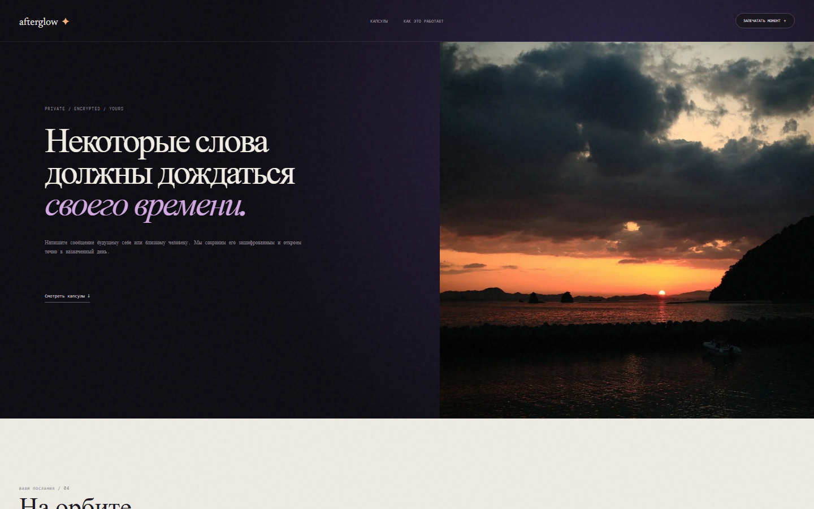
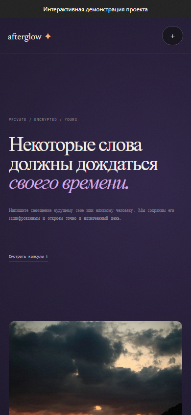

# Afterglow - цифровые капсулы времени

Защищённое паролем сообщение, которое можно открыть после выбранной даты.

[Открыть проект](https://memorim.github.io/afterglow-time-capsules/)





## Возможности

- Создание капсулы, получение её идентификатора и открытие по паролю после срока.
- Шифрование текста и серверная проверка даты и пароля.
- Адаптивный интерфейс с фотографическим первым экраном.

## Стек и устройство

JavaScript, Express, Zod, встроенный SQLite в Node.js и HTML/CSS.

## Ключевые решения

- Ключи выводятся через scrypt со случайной солью; текст шифруется AES-GCM со случайным IV и проверкой целостности. Публичные метаданные не содержат открытый текст.
- Некорректный JSON возвращает ограниченную ошибку без стека фреймворка.
- Инициализация SQLite выполняется в `BEGIN IMMEDIATE`: два процесса не создают повторные начальные записи. Существующая пустая база не заполняется заново.
- Даты с часовым смещением сохраняются в UTC; повреждённая дата блокирует открытие. Решение принимает сервер, а не часы браузера.

## Локальный запуск

Node.js 24.18.0 и pnpm 11.7.0; версии закреплены в файлах проекта.

```bash
npm install --global pnpm@11.7.0
pnpm install --frozen-lockfile
pnpm start
```

Откройте `http://localhost:4800`. Поддерживается локальная работа одного оператора: сервер слушает только loopback и проверяет адрес соединения, Host и Origin API-запросов. Для разработки доступен `pnpm dev`.

## Настройки

Параметры перечислены в [.env.example](.env.example). `pnpm start` использует окружение процесса и не загружает файл автоматически. После копирования `.env` его можно загрузить явно: `node --env-file=.env server.js`.

## Данные и обновления

SQLite хранится в `data/afterglow.db`. Инициализация создаёт или обновляет схему. Перед обновлением сохраните резервную копию; удалять БД вместо миграции не нужно.

## Проверки

```bash
pnpm test
pnpm test:contract
pnpm test:upgrade
pnpm exec playwright install --with-deps --only-shell chromium
pnpm test:e2e
pnpm audit --audit-level=high
```

Unit/API-проверки включают изменение ciphertext/tag, неверный пароль, точную границу времени, ошибки БД, лимиты запросов и параллельную запись двух процессов в временную БД с последующим открытием. Отдельно проверяются контракт ответа, сохранность предыдущей схемы и браузерное восстановление после ошибки сети.

Браузерные проверки запускают отдельную SQLite в памяти и не используют обычную папку `data`.

CI устанавливает зависимости по зафиксированным версиям и запускает настроенные проверки. Отдельная проверка документации находит неверные локальные ссылки и изображения. Проверка уязвимостей учитывает известные проблемы на момент запуска.

## Ограничения

- Шифрование выполняется на сервере и не является сквозным: сервер получает пароль и сообщение. Доступны отдельные аккаунты с изоляцией БД в режиме APP_ACCOUNTS.
- Временная блокировка действует в API. Владелец БД с паролем может расшифровать сообщение вне приложения раньше срока; криптографическая бл…4061 tokens truncated…3fриложения и переносите на независимый защищённый носитель. Старые снимки не удаляются автоматически: оператор задаёт срок хранения и контролирует место. Восстанавливайте выбранную БД командой `maintenance.mjs restore SOURCE NEW_DESTINATION`, остановив обслуживающий её сервер, и проверяйте открытие тестовой капсулы.

### Ежедневные копии с проверкой восстановления

[Установка systemd-таймера](docs/SCHEDULED_BACKUPS.md) и `node scripts/verified-backup.mjs DATA_DIRECTORY BACKUP_DIRECTORY` создают снимок и проверяют восстановление каждой базы во временном каталоге. Код не заменяет рабочие БД и не удаляет старые архивы. Установку на целевом сервере и независимое хранилище настраивает оператор.
